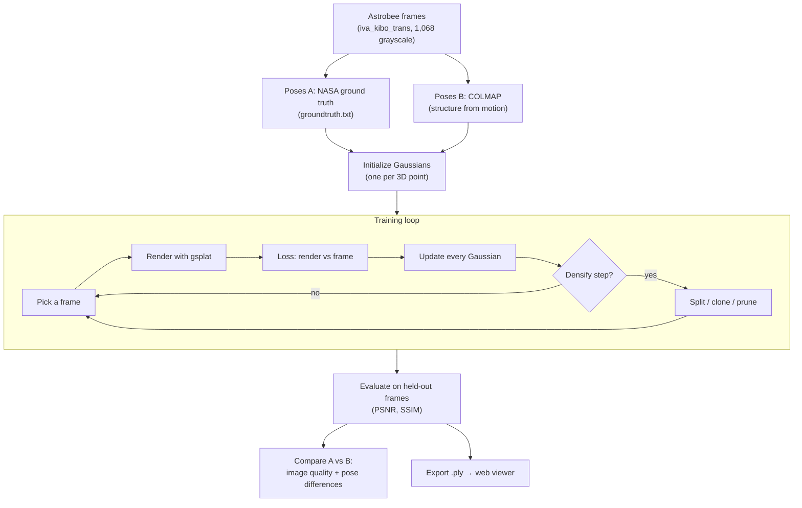
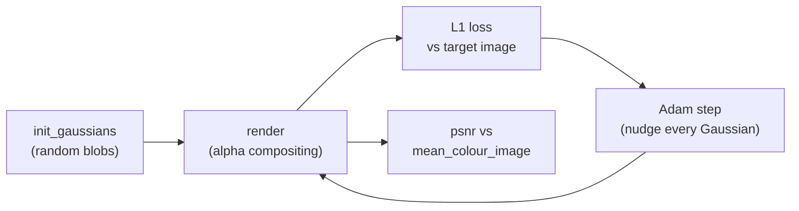
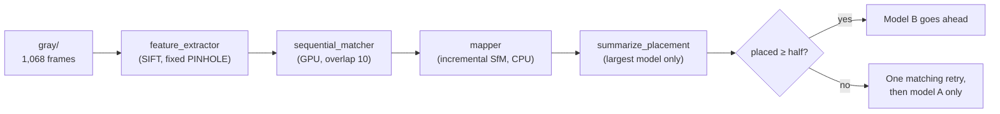

# kibo-splat explainer

Your refresher for explaining this project to a recruiter or interviewer. Plain English first,
key technical terms kept and defined. Kept current as the project is built.

## The two-minute pitch

I built a 3D model of the inside of the International Space Station's Japanese module, Kibō, from
the camera footage of NASA's Astrobee robot, using a technique called 3D Gaussian splatting. I also
tested a question the one published Kibō splat left open: are the camera positions NASA ships
with the dataset accurate enough to train it, or do you have to recompute them from the images?

*(Results go here once they exist. No numbers until they're measured.)*

## How the system works

1. **Frames in.** 1,068 grayscale images from Astrobee's navigation camera as it flies 11.5 m through Kibō.
2. **Camera poses.** For each frame: where was the camera, and which way was it pointing? Two sources:
   NASA's ground truth (A), or COLMAP recomputing them from the images (B). This is the experiment.
3. **Initialize.** Start with one fuzzy blob (a Gaussian) per known 3D point.
4. **Training loop.** Render the blobs from a frame's camera, measure how different the render is from
   the real frame, nudge every blob to reduce that difference, and repeat thousands of times.
   Every so often, add blobs where detail is missing and delete useless ones (densification).
5. **Evaluate.** Score renders against frames the model never trained on.
6. **Compare and ship.** A vs B on quality and pose differences; export the best splat to a web viewer.

### Warm-up: the 2D toy

Before any cameras, `src/kibo_splat/toy2d.py` fits flat 2D Gaussians to a single image. It is the
training loop with the 3D parts removed, so the core idea can be seen on its own:

The renderer is plain PyTorch and evaluates every Gaussian at every pixel, so the maths is readable
in a few lines. That costs memory, which is why the 3D trainer will use gsplat's tiled CUDA rasterizer.

### Day 1 gate: can COLMAP place the frames?

Model B only exists if COLMAP can recover poses from the images alone. Before any training,
`src/kibo_splat/colmap_run.py` runs COLMAP by itself and counts the frames it placed:

Only the largest model counts: if COLMAP loses track it starts a new model with its own scale and
origin, and frames in separate models can't train one splat together. Result: **540 of 1,068 frames
(50.6%) in one model when the verdict was called, so model B goes ahead.** Caveat: the mapper was
still running, so the final rate isn't measured yet. The margin over half was 6 frames. Details:
`docs/colmap-check.md`.

## Key concepts

- **Gaussian splatting**: represent a scene as millions of small, fuzzy, colored 3D blobs. Each has a
  position, shape, rotation, color and opacity. Drawing them is fast enough for real time.
- **Novel view synthesis**: rendering the scene from an angle no photo was taken from. The goal of splatting.
- **Camera pose**: a camera's position plus orientation. Training needs one per image.
- **Parallax / triangulation**: seeing the same point from different *positions* pins down its 3D location.
  A camera that only turns (a panorama) gives no depth information.
- **COLMAP (structure from motion)**: software that recovers camera poses and a sparse 3D point cloud
  by matching features across overlapping images.
- **Sequential matching**: for video, match each frame only with its neighbours in time (plus a few
  farther jumps), not every possible pair. Neighbouring frames overlap most, so this finds most good
  matches at a fraction of the cost.
- **Incremental mapping**: COLMAP's way of building the reconstruction. It starts from one good pair
  of frames, then adds frames one at a time, solving each new camera and triangulating new points.
- **Bundle adjustment**: a joint re-fit of every camera pose and 3D point to minimise reprojection
  error (how far each point lands from where it was seen). It keeps errors from piling up, but a
  *global* one re-fits everything placed so far, so it gets slower as the model grows.
- **PSNR / SSIM**: standard image-similarity scores, measured on held-out frames.
- **Alpha compositing / transmittance**: how overlapping blobs combine into one pixel. Each blob adds
  its color × its opacity × the light that got through everything in front of it. That leftover light
  is the *transmittance*, T = Π(1 − α) over the blobs in front. The 2D toy uses this formula, and the
  3D trainer will use the same one; in 3D, "in front" means closer to the camera.
- **Reparameterization (sigmoid, exp)**: the optimizer works with unconstrained numbers, and we map
  them into their valid range when rendering. Opacity and color go through a sigmoid (always 0–1),
  and size goes through exp (always positive). Without that, a gradient step could produce a negative
  size or an opacity above 1.
- **L1 loss**: the average absolute pixel difference between render and target. Gradient descent
  (here the Adam optimizer) nudges every Gaussian to shrink it.
- **Null-case baseline**: a degenerate "model" a real result must beat. For the 2D toy, that's an
  image filled with the target's mean color. If our fit's PSNR isn't clearly above it, the fit has
  learned nothing.

## Challenges

- **Finding NASA imagery that splats.** Most NASA camera data turned out to be panoramas: the camera
  turns but barely moves. We measured this from metadata before downloading or training anything
  (e.g. the Node 2 sequence: 3 cm of movement while turning 145°). Full survey: `docs/data-candidates/`.
- **COLMAP was slow, not stuck.** The worry was that forward motion along the module would defeat
  COLMAP. It didn't: frames kept being placed into one model. The real problem was time. The pip
  `pycolmap` has no CUDA, and CPU matching was on course to take hours. We noticed by reading
  progress straight from COLMAP's database, switched to the official CUDA build, and kept the
  database, so the remaining matches took 274 s. Mapping stayed CPU-bound (this build's solver has no
  GPU support): each global bundle adjustment pass mostly took longer than the last, from 12 min at
  328 frames to 45 min at 495, and getting past half took 3 h 47 min. What it taught us:
  measure progress early instead of trusting a time estimate, and give long jobs checkpoints. This
  run kept its model only in memory, so the final placement rate needs a resumable rerun.

## Headline results

*(None yet.)*

## Honest limitations

- Grayscale, low-resolution navigation camera: no color, limited fine texture.
- The camera mostly looks along the module, so the splat is best from viewpoints near its path.
