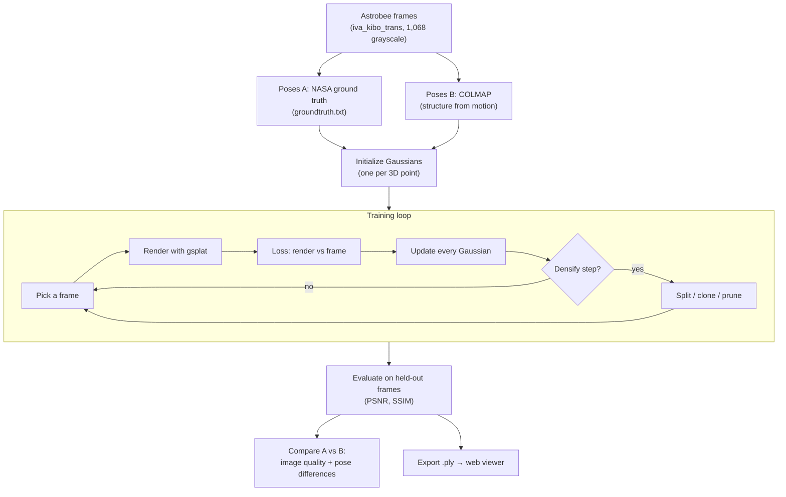

# kibo-splat explainer

Your refresher for explaining this project to a recruiter or interviewer. Plain English first,
key technical terms kept and defined. Kept current as the project is built.

## The two-minute pitch

I built a 3D model of the inside of the International Space Station's Japanese module, Kibō, from
the camera footage of NASA's Astrobee robot, using a technique called 3D Gaussian splatting. I also
tested a question the one published Kibō splat left open: are the camera positions NASA ships
with the dataset accurate enough to train it, or do you have to recompute them from the images?

*(Results go here once they exist. No numbers until they're measured.)*

## How the system works

1. **Frames in.** 1,068 grayscale images from Astrobee's navigation camera as it flies 11.5 m through Kibō.
2. **Camera poses.** For each frame: where was the camera, and which way was it pointing? Two sources:
   NASA's ground truth (A), or COLMAP recomputing them from the images (B). This is the experiment.
3. **Initialize.** Start with one fuzzy blob (a Gaussian) per known 3D point.
4. **Training loop.** Render the blobs from a frame's camera, measure how different the render is from
   the real frame, nudge every blob to reduce that difference, and repeat thousands of times.
   Every so often, add blobs where detail is missing and delete useless ones (densification).
5. **Evaluate.** Score renders against frames the model never trained on.
6. **Compare and ship.** A vs B on quality and pose differences; export the best splat to a web viewer.

## Key concepts

- **Gaussian splatting**: represent a scene as millions of small, fuzzy, colored 3D blobs. Each has a
  position, shape, rotation, color and opacity. Drawing them is fast enough for real time.
- **Novel view synthesis**: rendering the scene from an angle no photo was taken from. The goal of splatting.
- **Camera pose**: a camera's position plus orientation. Training needs one per image.
- **Parallax / triangulation**: seeing the same point from different *positions* pins down its 3D location.
  A camera that only turns (a panorama) gives no depth information.
- **COLMAP (structure from motion)**: software that recovers camera poses and a sparse 3D point cloud
  by matching features across overlapping images.
- **PSNR / SSIM**: standard image-similarity scores, measured on held-out frames.

## Challenges

- **Finding NASA imagery that splats.** Most NASA camera data turned out to be panoramas: the camera
  turns but barely moves. We measured this from metadata before downloading or training anything
  (e.g. the Node 2 sequence: 3 cm of movement while turning 145°). Full survey: `docs/data-candidates/`.

## Headline results

*(None yet.)*

## Honest limitations

- Grayscale, low-resolution navigation camera: no color, limited fine texture.
- The camera mostly looks along the module, so the splat is best from viewpoints near its path.
